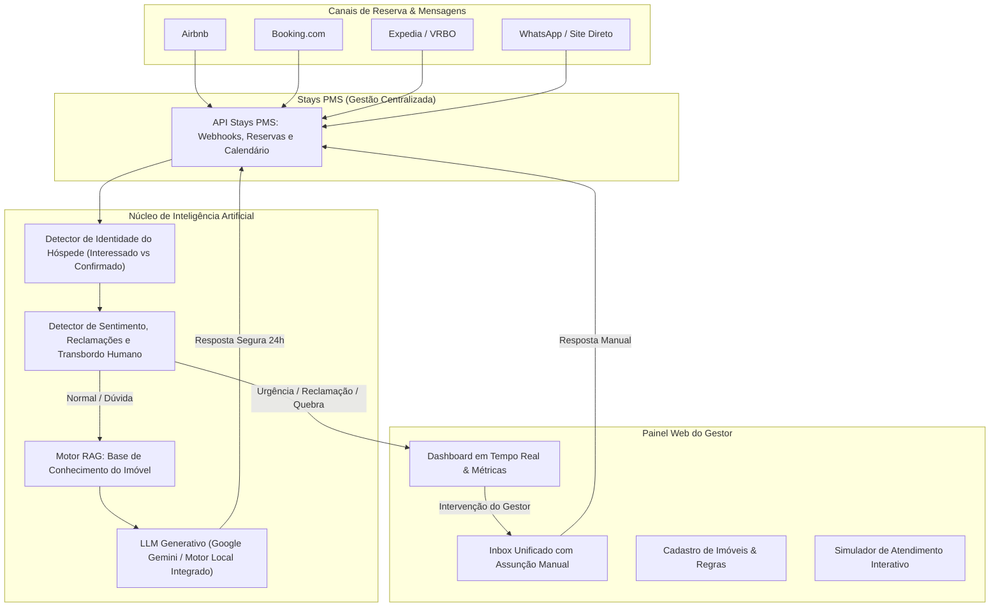

# HospedaAI 🏨🤖
> **Agente de IA Generativa para Aluguel por Temporada integrado ao Stays PMS**  
> *Disciplina de Projetos de IA — Sistemas de Informação*  
> **Centro Universitário de Excelência**  
> **Professora:** Elienaide Machado  
> **Equipe:** Kailla Costa, Erick Dos Santos, Vinicius De Oliveira e Laysa Lima

---

## 📌 1. Visão Geral do Projeto

O **HospedaAI** é uma solução completa desenvolvida para solucionar uma das maiores dores operacionais de anfitriões e administradoras de aluguel por temporada: o volume massivo e ininterrupto de dúvidas repetitivas enviadas por hóspedes antes da reserva (como garagem, roupa de cama e itens da cozinha) e durante a estadia (como horários de check-in/out, senha do Wi-Fi e código da porta).

Conectado ao **PMS da Stays** — o sistema de gestão central que unifica os anúncios e canais de venda como **Airbnb**, **Booking.com**, **Expedia** e canais diretos —, o HospedaAI atua como um agente autônomo 24 horas por dia em linguagem natural e múltiplos idiomas, com duas barreiras fundamentais de inteligência de negócio:

1. **Barreira de Segurança para Dados Sensíveis:** A IA identifica pelo PMS se o interlocutor é apenas um **interessado (lead)** ou se já possui uma **reserva confirmada (hóspede)**. Informações sensíveis — como a senha do Wi-Fi e o código da fechadura digital — são bloqueadas com educação para interessados e liberadas automaticamente para hóspedes confirmados.
2. **Transbordo Humano Inteligente (Escalação com Alerta Crítico):** Se o hóspede relata uma emergência física ou problema no imóvel (ex.: vazamento de água, falta de luz, ar-condicionado quebrado) ou solicita cancelamento/desconto extraordinário, a IA detecta a criticidade, acalma o hóspede com medidas imediatas de contenção e transfere a conversa para o gestor com alerta prioritário no painel.

---

## 🏗️ 2. Arquitetura da Solução



---

## 🚀 3. Funcionalidades Principais

### 1. Painel Web do Gestor (Dashboard)
- **KPIs em Tempo Real**: Total de atendimentos, taxa de resolução autônoma por IA (ex.: 88%), volume de transbordos humanos e reservas sincronizadas.
- **Status do Hub Stays PMS**: Monitoramento da conexão com Airbnb, Booking.com, Expedia e canais diretos.
- **Histórico e Atendimentos Recentes**: Acompanhamento dinâmico das conversas em andamento.

### 2. Central de Atendimento & Transbordo (Inbox Unificado)
- Caixa de entrada consolidada com filtros por status (`Todas`, `🤖 IA Ativa`, `🚨 Transbordo Humano`, `✅ Finalizadas`).
- Badges visuais indicando a plataforma de origem (Airbnb, Booking, Expedia, WhatsApp) e status da reserva (`🟢 Hóspede Confirmado` vs `🟡 Interessado`).
- **Botão "Assumir Atendimento Humano"**: Permite ao gestor intervir a qualquer momento, desativando temporariamente as respostas da IA para responder manualmente.
- **Botão "Devolver para a IA"**: Reativa o agente autônomo.
- **Painel de Auditoria & Raio-X da IA**: Exibe a justificativa da decisão da IA, a verificação de segurança efetuada e a base de conhecimento RAG consultada.

### 3. Gestão de Imóveis & Base de Conhecimento (RAG)
- Cadastro detalhado de cada propriedade:
  - Capacidade de hóspedes, quartos, banheiros, horários de check-in e check-out, horário de silêncio.
  - **Dados Sensíveis Protegidos**: Nome da rede Wi-Fi, senha do Wi-Fi, tipo de acesso (fechadura digital, cofre de chave, portaria) e código da fechadura.
  - **Comodidades**: Roupa de cama e banho inclusa, ar-condicionado, cozinha completa, garagem privativa, etc.
  - **Regras da Casa**: Proibição de fumo, festas, políticas de animais de estimação (pets).
  - **Instruções de Check-in e Check-out**.
  - **Dicas da Região**: Gastronomia, mercados e pontos turísticos.

### 4. Hub de Reservas do Stays PMS
- Tabela de hóspedes e reservas sincronizadas com código Stays, período, canal e status (`Checked-In`, `Confirmada`).
- Permite simular a criação de novas reservas instantaneamente para testes.

### 5. Simulador Interativo do Hóspede (Guest App)
- Interface de smartphone realista para apresentações acadêmicas ao vivo.
- **3 Cenários Pré-configurados**:
  - 🟡 **Carlos Silva (Interessado / Lead)**: Faz perguntas sobre garagem, enxoval de cama e tenta pedir a senha do Wi-Fi. A IA responde às comodidades e bloqueia a senha com cordialidade ("liberada no dia do check-in após confirmação").
  - 🟢 **Mariana Costa (Hóspede Confirmada no Airbnb)**: Pede a senha do Wi-Fi e o código da porta. A IA reconhece a reserva no PMS e fornece todas as instruções de acesso!
  - 🚨 **Roberto Souza (Emergência no Imóvel)**: Digita "O chuveiro quebrou e está vazando água pelo chão!". A IA aciona o transbordo humano, emite instruções de contenção rápida e sinaliza alerta crítico no painel do anfitrião.

---

## 💻 4. Como Executar o Projeto

### Pré-requisitos
- O projeto já possui o executável portátil do Node.js incluído no próprio diretório, pronto para execução imediata no Windows!

### Executando em 1 Clique (Windows):
1. Dê um duplo clique no arquivo **`start.bat`** na raiz do projeto.
2. O servidor iniciará automaticamente e abrirá o navegador no endereço:
   👉 **`http://localhost:3000`**

### Ou via Linha de Comando:
```powershell
# Execução direta com o Node portátil do projeto:
.\node.exe src\server.js

# Ou com o Node instalado no sistema:
node src\server.js
```

---

## 🛠️ 5. Tecnologias Utilizadas

- **Backend**: Node.js v24 (com motor nativo `node:sqlite` para persistência relacional SQLite ultrarrápida, sem dependências de compilação C++).
- **Framework Web**: Express.js com arquitetura RESTful e CORS.
- **Inteligência Artificial**:
  - Motor Híbrido RAG Integrado (execução offline instantânea de extração semântica, intenções e guardrails de segurança).
  - Conector nativo para a API **Google Gemini 1.5 Flash** (configurável via interface).
- **Frontend**: Single Page Application responsiva com Tailwind CSS, Lucide Icons, animações fluidas e design system profissional para hospitalidade.
- **Banco de Dados**: SQLite persistido em arquivo (`hospeda_ai.db`).

---

## 🎓 6. Ficha de Identificação Acadêmica

- **Instituição:** Centro Universitário de Excelência
- **Curso:** Sistemas de Informação
- **Disciplina:** Disciplina de Projetos de IA
- **Professora Orientadora:** Elienaide Machado
- **Título do Trabalho:** HospedaAI — Agente de IA para Aluguel por Temporada Integrado ao Stays PMS
- **Integrantes da Equipe:**
  1. Kailla Costa
  2. Erick Dos Santos
  3. Vinicius De Oliveira
  4. Laysa Lima

